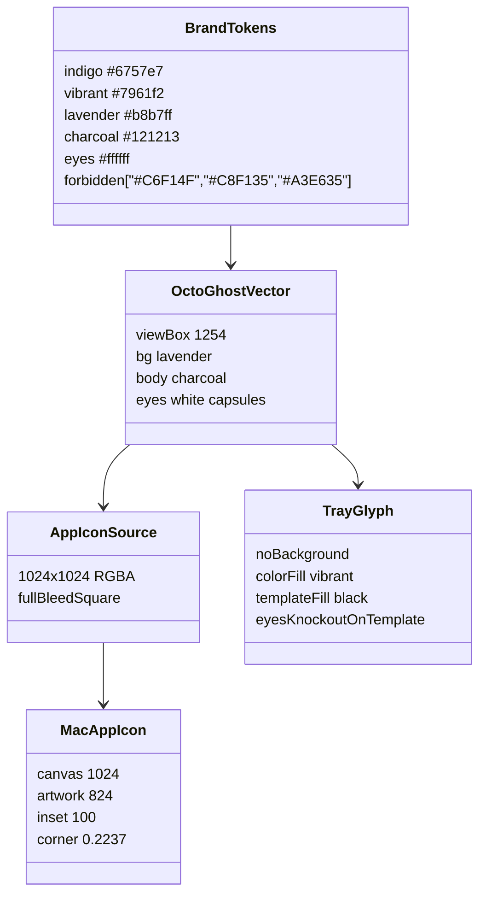
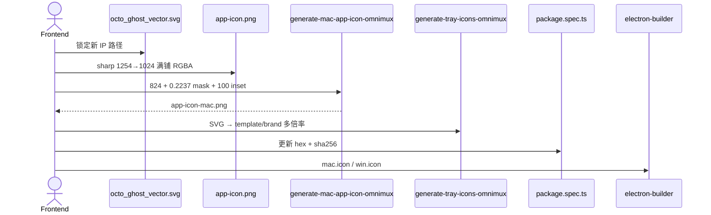
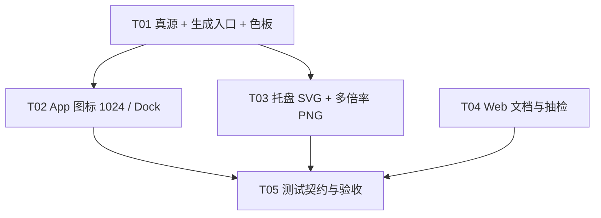

# OmniMux 紫色品牌图标全量协同更新 — 系统设计与前端任务清单

> **角色**：架构师 高见远（Gao）
> **范围**：全量协同更新（App 图标 + 页面内品牌 Logo/IP 图标）
> **仓库 A**：`OmniMux`（Web / 平台主仓，与本仓库同级 checkout）
> **仓库 B**：`omnimux-desktop-fork`（桌面客户端构建源，发运线，即本仓库）
> **规范**：仓库 A 的 `DESIGN.md` 2.0.0 Violet & Indigo Brand Refresh
> **结论先行**：仓库 A 的 Web/PWA/Landing/品牌套件 **已经换紫**；仓库 B 的 Dock / Windows 应用图标 / 系统托盘 **仍是旧版荧光绿章鱼**，是本次工程的主战场。无后端接口变更，全部由前端落地。

---

## Part A: System Design

### 1. Implementation Approach

#### 1.1 核心技术挑战

| 难点 | 说明 | 处理策略 |
| --- | --- | --- |
| 双仓不同步 | A 已完成香芋紫 Logo 套件；B 仍锁旧绿 `app-icon.png` SHA-256，测试会挡新图 | 以 A 的矢量 IP 为唯一真源，B 只消费栅格/托盘派生件，并同步改测试契约 |
| 两套 IP 形体 | 旧托盘 SVG 是 C2-lively-v2（灯球、豆形眼、`#C6F14F` 身体）；新 IP 是幽灵剪影 + 胶囊大眼 | **禁止**只改 fill 色。必须换路径，否则「绿章鱼换紫」仍是旧形象 |
| macOS Dock 几何 | 脚本已实现 824 画心 + 100px 透明 inset + 22.37% 圆角遮罩 | 源图必须是 **满铺直角方图**。若用品牌套件 `rx=280` 的圆角 SVG 再跑遮罩，会双重圆角、安全区被吃掉 |
| 16px 托盘可读性 | 香芋紫 `#b8b7ff` 在浅色菜单栏几乎看不见 | App 图标用 Lavender 底；彩色托盘用 Vibrant `#7961f2`；macOS Template 用黑/透明挖空 |
| Template 眼睛 | macOS `setTemplateImage(true)` 只认黑/透明，白色眼睛会变成「一块黑团」 | Template 变体把眼睛做成 **透明挖空（knockout）**，彩色变体保留白眼 |
| 测试锁死旧色 | `package.spec.ts` 断言 `tray-icon.svg` 恰好 1 处 `#C6F14F`，且 `app-icon.png` digest 固定 | 生成新图后 **必须** 改断言，否则 `yarn test` / `check:mac-package` 失败 |
| 页面内「图标」范围 | 管理台大量 Hugeicons/antd 是 `currentColor`，不是品牌 IP | 本次 **不** 批量重绘功能图标；只换品牌 Logo / Favicon / Dock / Tray / Landing IP |

#### 1.2 框架与库选择

- **栅格化**：仓库 B 已有 `sharp`（`generate-mac-app-icon-omnimux.mjs` / `generate-tray-icons-omnimux.mjs`）。继续用 sharp，不引入 ImageMagick / `canvas` / 在线图标工厂。
- **矢量真源**：仓库 A `assets/ip_design/octo_ghost_vector.svg`（与 Landing 副本字节级一致）。
- **macOS 圆角**：沿用现成 `MAC_APP_ICON_CORNER_RADIUS_RATIO = 0.2237` 与 `dest-in` 遮罩，不手绘超椭圆。
- **Electron 消费**：
  - Darwin Dock / 包图标 → `build/app-icon-mac.png`
  - Win/Linux 应用图标 → `build/app-icon.png`
  - Darwin 托盘 → `tray-iconTemplate.png`（`setTemplateImage(true)`）
  - Win/Linux 托盘 → `tray-icon-blue.png`（文件名历史遗留，色值改为极光紫）
- **Web**：无新框架。`LogoMark` 已指向 `/logo.svg`；`DEFAULT_LOGO = '/logo.png'`。页面功能图标走现有 icon 库的 `currentColor`，跟随 CSS token，无需换文件。

#### 1.3 架构模式

资产流水线，而不是应用 MVC：

```
Brand Tokens (DESIGN.md)
        │
        ▼
Canonical Vector (octo_ghost_vector.svg)
        │
        ├──► AppIconSource 1024 满铺方图 ──► MacIconGenerator ──► app-icon-mac.png
        │                                              └──► electron-builder mac.icon
        │                         └──► electron-builder win/linux.icon
        │
        ├──► TrayGlyph SVG（无底、同一剪影）──► TrayIconGenerator
        │         ├── template 黑/挖空眼
        │         └── brand  #7961f2 + 白眼
        │
        └──► Web public（已完成，本轮只做抽检 + 文档纠偏）
```

原则：

1. **单一矢量真源**，禁止再从 gpt-image-2 旧绿 PNG 描摹。
2. **生成物可复现**：`yarn workspace dsh-plugin-desktop build` 的前两步必须能从源图重生 mac/tray 派生件。
3. **测试即色板契约**：hex 与 sha256 跟着新资产走，不允许「图已换、测试仍锁绿」。

---

### 2. File List

#### 2.1 仓库 A（多数已是紫，本轮以抽检/文档为主）

| 路径 | 现状 | 本轮动作 |
| --- | --- | --- |
| `assets/ip_design/octo_ghost_vector.svg` | 香芋紫底 `#b8b7ff` + `#121213` + 白胶囊眼 | **真源，只读** |
| `web/src/features/omnimux-landing/assets/octo_ghost_vector.svg` | 与真源一致 | 抽检 |
| `web/src/features/omnimux-landing/assets/doodle-*.svg` `underline-*.svg` | stroke `#6757e7` | 已对齐，不动 |
| `web/src/features/omnimux-landing/assets/octo_agent_*.png` | 紫黑插画，非荧光绿 | 不动 |
| `web/src/features/omnimux-landing/components/logo-mark.tsx` | `` | 只改过时注释 |
| `web/public/logo.svg` `logo.png` | 已紫 | 抽检 |
| `web/public/favicon.ico` `favicon-16x16.png` `favicon-32x32.png` | 已紫 | 抽检 |
| `web/public/apple-touch-icon.png` `icon-192.png` `icon-512.png` `maskable-icon-512.png` | 已紫 | 抽检 |
| `web/public/og.png` | 深紫海军底 + 香芋紫 IP，**无绿** | 保持（OG 用深色画布符合 DESIGN 深色容器） |
| `web/public/manifest.webmanifest` | 指向上述 PNG | 不动 |
| `docs/brand/assets/logo-lavender-black.{svg,png}` | 主力圆角变体 | 品牌套件，不直接进 Dock |
| `docs/brand/assets/logo-vibrant-purple-black.{svg,png}` | 高能变体 | 备用 |
| `docs/brand/assets/logo-indigo-black.{svg,png}` | `#6757e7` | 备用 |
| `docs/brand/assets/logo-purple-white.{svg,png}` | 反白 IP | 深色场景备用 |
| `electron/icon.png` | 已紫 512 | 抽检 |
| `electron/tray-iconTemplate.png` `@2x` | 黑剪影（旧形体，gateway 壳） | P2，与发运桌面无关 |
| `electron/tray-icon-windows.png` | 黑剪影 | P2 |
| `electron/create-tray-icon.js` | 过时「API」文字占位生成器 | 不调用 |
| `FORK_CUSTOMIZATIONS.md` | **仍写 chartreuse `#C6F14F`** | **必须改文案**，避免下轮 Agent 按旧规范回滚 |

明确 **不改**：`web/src/assets/brand-icons/*`（第三方平台色）、`web/public/landing/platforms/*`、Hugeicons/antd 功能图标、`web/index.html` 的 `theme-color #0A0A0B`（启动壳，不是 Logo）。

#### 2.2 仓库 B（主改）

| 路径 | 现状 | 本轮动作 |
| --- | --- | --- |
| `dsh-plugin-desktop/build/app-icon.png` | 1024 RGBA，**旧海军底 + 荧光绿章鱼**（greenish≈36 万像素） | **重栅格为香芋紫新 IP** |
| `dsh-plugin-desktop/build/app-icon-mac.png` | 由上一张生成，同样偏绿 | 脚本重生 |
| `dsh-plugin-desktop/build/tray-icon.svg` | `#C6F14F` + `#101B2B` + `#232A35` 旧形体 | **整文件替换为无底新剪影** |
| `dsh-plugin-desktop/build/tray-icon-source-blue-16.png` `*-32.png` | 绿 | 重生为 `#7961f2` |
| `dsh-plugin-desktop/build/tray-icon-source-16.png` `*-32.png` | 黑，但是旧形体 | 重生为新剪影 |
| `dsh-plugin-desktop/build/tray-icon-blue.png` 及 `@1.25x` `@1.5x` `@2x` | 绿 | 脚本重生 |
| `dsh-plugin-desktop/build/tray-iconTemplate.png` `@2x` | 黑旧形体 | 脚本重生 |
| `dsh-plugin-desktop/scripts/generate-mac-app-icon-omnimux.mjs` | 几何正确 | 逻辑保留，注释标明源图约束 |
| `dsh-plugin-desktop/scripts/generate-tray-icons-omnimux.mjs` | 注释仍写 chartreuse；从 32px PNG 缩放 | 改为以 SVG 为源 + `#7961f2` |
| `dsh-plugin-desktop/scripts/generate-tray-icons.mjs` | 上游 DSH 蓝 `#4D6BFE`，**不进 OmniMux build** | 不动（避免污染 upstream 脚本） |
| `dsh-plugin-desktop/scripts/generate-mac-app-icon.mjs` | 上游 ICC/RGBA16 版本，不进 OmniMux build | 不动 |
| `dsh-plugin-desktop/tests/package.spec.ts` | 锁 `#C6F14F` 与旧 sha256 `ad1baf258…` | **更新契约** |
| `dsh-plugin-desktop/src/index.ts` | darwin→mac png，else→app-icon.png | 不动路径 |
| `dsh-plugin-desktop/src/tray-icons.ts` | darwin template / else bluePath | 不动路径 |
| `dsh-plugin-desktop/package.json` `build.mac.icon` / `win.icon` | 已指向上述 png | 不动路径 |
| `dsh-plugin-desktop/README.md` `README.zh.md` | 仍写「brand-blue tray」 | 改为极光紫 |

建议新增（T01，便于复现，不强制独立 npm script）：

| 路径 | 用途 |
| --- | --- |
| `dsh-plugin-desktop/scripts/generate-app-icon-source-omnimux.mjs` | 从 A 仓矢量（或本地拷贝）sharp 出 1024 `app-icon.png` |
| `dsh-plugin-desktop/build/octo-ghost-app.svg` | 可选：把真源方图 SVG 拷进 B，避免构建机读不到 A 仓 |

`.worktrees/**` 下的同名脚本是历史 worktree，**不要改**。

---

### 3. Data Structures and Interfaces

完整 class 图见 `docs/class-diagram.mermaid`。



#### 3.1 色板契约（图标专用，禁止再用旧绿）

| Token | Hex | 用于 |
| --- | --- | --- |
| `--logo-bg-lavender` | `#b8b7ff` | App 图标 / Favicon / PWA 底 |
| `--logo-bg-vibrant` | `#7961f2` | 高能变体、**彩色托盘身体** |
| `--brand-indigo` | `#6757e7` | 品牌套件备用、Landing 装饰 stroke |
| `--logo-mascot-charcoal` | `#121213`（矢量里已用；规范亦允许 `#0c0f17`） | App 图标 IP 身体 |
| `--logo-mascot-eyes` | `#ffffff` | 彩色/App 图标眼睛 |
| 禁用 | `#C6F14F` `#C8F135` `#A3E635` 及近似酸性绿 | 任何新资产 |

#### 3.2 生成器接口（已存在，保持签名）

```ts
// generate-mac-app-icon-omnimux.mjs
export const MAC_APP_ICON_CANVAS_SIZE = 1024
export const MAC_APP_ICON_ARTWORK_SIZE = 824
export const MAC_APP_ICON_INSET = 100
export const MAC_APP_ICON_CORNER_RADIUS_RATIO = 0.2237
export function roundedRectMaskSvg(size: number, radius: number): Buffer
export function applyAppleIconCornerMask(png: Buffer, size: number): Promise<Buffer>
export function generateMacAppIconOmnimux(source?: string, output?: string): Promise<void>
```

建议托盘脚本改为：

```ts
const BRAND_VIOLET = '#7961f2'
// tray-icon.svg 必须：1) 恰好一处 fill=BRAND_VIOLET；2) 无 <style>/prefers-color-scheme；3) 无实心底砖
async function renderTray(svg: string, fill: string, size: number, file: string): Promise<void>
```

#### 3.3 运行时消费（不要改 API）

```ts
iconFilename = platform === 'darwin' ? 'app-icon-mac.png' : 'app-icon.png'
trayIcons = { templatePath: 'tray-iconTemplate.png', bluePath: 'tray-icon-blue.png' }
prepareTrayIcon(assets, platform): NativeImage
```

HTTP/API 合同：本次 **无**。前后端无需对表。

---

### 4. Program Call Flow

完整时序见 `docs/sequence-diagram.mermaid`。



#### 4.1 App 图标换算（必须按此几何，禁止手调）

1. 输入：`octo_ghost_vector.svg`（**直角** `rect` 底，不要用 `docs/brand` 的 `rx="280"` 版本）。
2. `sharp(svg, { density: 384 }).resize(1024, 1024).ensureAlpha().png()` → `build/app-icon.png`。
3. 校验：`width=height=1024`、`hasAlpha=true`、`format=png`；中心像素为炭黑身体；四角透明或香芋紫（满铺底则为紫，四角不透明也可以，Windows 会自己遮罩）。
4. 推荐源图 **满铺不透明香芋紫底**（与已上线 `web/public/logo.png` 一致）。Mac 脚本会把整张图缩到 824 再圆角，外圈 100px 变透明——这就是 Dock 安全边距。
5. `node scripts/generate-mac-app-icon-omnimux.mjs` → `app-icon-mac.png`。
6. 几何验收（已有测试）：trim 后 `824×824`，`trimOffsetLeft/Top = -100`。

#### 4.2 托盘换算

1. 从同一 `path` 做 **无背景** SVG：身体 `fill="#7961f2"`，眼睛 `fill="#ffffff"`，可加 `rx` 小圆角透明画布，但不要海军底。
2. 彩色输出：按 16/20/24/32 缩放，文件名仍叫 `tray-icon-blue*.png`。
3. Template：身体改 `#000000`，眼睛改为透明（删除白眼 rect，或 `fill="none"`），输出 `tray-iconTemplate.png`（16）与 `@2x`（32）。
4. Darwin 运行时 `template.setTemplateImage(true)`，系统按菜单栏浅/深自动反色。
5. Win/Linux 使用彩色 PNG。

#### 4.3 Web / Landing

无需生成管线。`LogoMark` → `/logo.svg`；登录/侧栏 → `systemConfig.logo` 默认 `/logo.png`。抽检即可。

---

### 5. Anything UNCLEAR

| 项 | 假设（本设计已选定） | 若产品推翻 |
| --- | --- | --- |
| Dock 底色用 Lavender 还是 Vibrant | **Lavender `#b8b7ff`**，与已上线 Web Favicon/PWA 一致 | 若要求「高能 Dock」，改用 `logo-vibrant-purple-black` 直角化后重栅格，托盘仍用 Vibrant |
| 炭黑精确值 | 矢量已是 `#121213`，不强制改 `#0c0f17` | 视觉差 < 2%，不要为对齐 token 重描 path |
| 仓库 A `electron/` | 非发运桌面；`icon.png` 已紫；tray 仍旧形体黑剪影 | 不阻塞发运。P2 再同步 |
| `og.png` 海军底 | 不算违规绿，保留深色 OG | 若要浅色 OG，另开视觉任务 |
| `theme-color #0A0A0B` | 启动壳，不是图标 | 不在本次范围 |
| 文件名 `tray-icon-blue*` | 历史命名，改名会动 Electron 路径与大量测试 | **不改名**，只改像素与注释 |
| 仓库 B 无 `octo_ghost_vector.svg` | T01 拷贝一份到 `dsh-plugin-desktop/build/` 或从绝对路径读 A 仓 | CI 若无 A 仓，必须把 SVG 提交进 B |
| 已安装 `/Applications/OmniMux.app` | 源码换图不会热更新 App 图标 | 需重新 `package:dir` / 安装包；用户可能要清图标缓存 |

---

## Part B: Task Decomposition

### 6. Required Packages

本次 **不新增依赖**。仓库 B 已具备：

```
- sharp（dsh-plugin-desktop 现有）：SVG/PNG 栅格、resize、圆角遮罩
- electron / electron-builder（现有）：消费 app-icon.png / app-icon-mac.png
- vitest（现有）：package.spec.ts 图标契约
```

仓库 A Web 侧无需新包。禁止再装 `canvas` 去跑 `electron/create-tray-icon.js`。

---

### 7. Task List（按依赖排序，硬上限 5）

> 全部任务给 **前端界面开发专家**。Backend 任务数 = 0。
> 每个任务 ≥ 3 个相关文件。T02/T03 在 T01 之后可并行。

#### T01 — 项目基础设施：锁定真源 + 生成入口 + 色板契约

- **Priority**: P0
- **Dependencies**: 无
- **Source Files**:
  - 仓库 A 的 `assets/ip_design/octo_ghost_vector.svg`（只读真源）
  - `dsh-plugin-desktop/build/octo-ghost-app.svg`（新建：直角方图拷贝，供 B 仓离线构建）
  - `dsh-plugin-desktop/scripts/generate-app-icon-source-omnimux.mjs`（新建：1254 SVG → 1024 RGBA `app-icon.png`）
  - `dsh-plugin-desktop/scripts/generate-tray-icons-omnimux.mjs`（改：以 SVG 为源，`BRAND_VIOLET='#7961f2'`，删除 chartreuse 注释）
  - `dsh-plugin-desktop/scripts/generate-mac-app-icon-omnimux.mjs`（仅注释：源图必须是满铺 1024 方图，禁止预圆角）
- **操作要点**:
  1. 拷贝真源 SVG 到 B 仓 `build/octo-ghost-app.svg`，保持直角底 `#b8b7ff`，不要用 `docs/brand/assets/logo-*-*.svg` 的 `rx=280`。
  2. 源脚本用 `sharp(svgBuffer, { density: 384 }).resize(1024,1024).ensureAlpha().png({ compressionLevel: 9 })`。
  3. 托盘脚本改为读 `build/tray-icon.svg`（T03 会替换内容，T01 先改管道，允许暂时仍是旧 SVG，但注释与 `BRAND_VIOLET` 常量先就位；若旧 SVG 不含该 hex，T01 不要跑生成，以免写坏 PNG——**T01 只改脚本，不跑旧绿重生**）。
  4. **不要**修改 `generate-tray-icons.mjs` / `generate-mac-app-icon.mjs`（上游 DSH 蓝/ICC 脚本）。
- **验证**: `node -e` 能 `import` 新脚本；旧 `package.spec.ts` 此时仍会红（预期，T05 才改断言）。

#### T02 — 桌面 App 图标（Windows/Linux 源图 + macOS Dock 派生）

- **Priority**: P0
- **Dependencies**: T01
- **Source Files**:
  - `dsh-plugin-desktop/build/app-icon.png`
  - `dsh-plugin-desktop/build/app-icon-mac.png`
  - `dsh-plugin-desktop/package.json`（确认 `build.mac.icon` / `win.icon` / `linux.icon` 路径不变，无需改字段）
- **命令**:

```bash
cd dsh-plugin-desktop
node scripts/generate-app-icon-source-omnimux.mjs
node scripts/generate-mac-app-icon-omnimux.mjs
```

- **像素门禁（生成后立刻跑）**:
  - `app-icon.png`：`1024×1024`、RGBA、主色 `#b8b7ff` + `#121213` + `#ffffff`。
  - `greenish` 像素（G>R+20 且 G>B+20 且 G>150）必须 ≈ 0。
  - 禁止出现 `#C6F14F` / `#C8F135` / `#A3E635`。
  - `app-icon-mac.png`：1024 画布，trim 透明后 824，offset -100，圆角外透明。
- **禁止**: 把 `docs/brand/assets/logo-lavender-black.png`（已圆角、512）直接拉升冒充 1024 源图。

#### T03 — 系统托盘（极光紫彩色 + macOS Template）

- **Priority**: P0
- **Dependencies**: T01
- **Source Files**:
  - `dsh-plugin-desktop/build/tray-icon.svg`
  - `dsh-plugin-desktop/build/tray-icon-source-32.png`
  - `dsh-plugin-desktop/build/tray-icon-source-16.png`
  - `dsh-plugin-desktop/build/tray-icon-source-blue-32.png`
  - `dsh-plugin-desktop/build/tray-icon-source-blue-16.png`
  - `dsh-plugin-desktop/build/tray-iconTemplate.png`
  - `dsh-plugin-desktop/build/tray-iconTemplate@2x.png`
  - `dsh-plugin-desktop/build/tray-icon-blue.png`
  - `dsh-plugin-desktop/build/tray-icon-blue@1.25x.png`
  - `dsh-plugin-desktop/build/tray-icon-blue@1.5x.png`
  - `dsh-plugin-desktop/build/tray-icon-blue@2x.png`
- **SVG 规范**:
  - 同一幽灵 `path`，**删除** `#101B2B` 底砖。
  - 身体恰好一处 `fill="#7961f2"`（测试按此计数）。
  - 白眼 `rect` 仅存在于彩色语义；Template 渲染时脚本必须把眼睛挖空。
  - 无 `<style>`、无 `prefers-color-scheme`。
- **命令**:

```bash
cd dsh-plugin-desktop
node scripts/generate-tray-icons-omnimux.mjs
```

- **验证**: 彩色 PNG `purpleish>0` 且 `greenish=0`；Template 仅黑/透明；16px 仍能看出「圆顶 + 两只竖眼」剪影，而不是旧灯球章鱼。

#### T04 — Web / Landing / 文档对齐（仓库 A 为主，B 文档为辅）

- **Priority**: P1
- **Dependencies**: 无（可与 T02/T03 并行；不依赖新桌面 PNG）
- **Source Files**:
  - `OmniMux/FORK_CUSTOMIZATIONS.md`（删除 chartreuse `#C6F14F` / `#101B2B` 旧 IP 描述，改为 DESIGN 2.0 香芋紫 + 曜石黑 + 白胶囊眼）
  - `OmniMux/web/src/features/omnimux-landing/components/logo-mark.tsx`（注释去掉 potrace/旧绿叙事，改为「共享 web/public/logo.svg，DESIGN 2.0 lavender IP」）
  - `dsh-plugin-desktop/README.md`
  - `dsh-plugin-desktop/README.zh.md`（「brand-blue tray / `#4D6BFE`」→「OmniMux 极光紫托盘 `#7961f2` + macOS Template」；并写明 build 调用的是 `*-omnimux.mjs`）
- **抽检清单（只读，已紫则不动文件）**:
  - `web/public/{logo.svg,logo.png,favicon.ico,favicon-16x16.png,favicon-32x32.png,apple-touch-icon.png,icon-192.png,icon-512.png,maskable-icon-512.png}`
  - `web/src/features/omnimux-landing/assets/{octo_ghost_vector.svg,doodle-left.svg,doodle-right.svg,underline-hero.svg,underline-section.svg,underline-faq.svg}`
  - `electron/icon.png`
- **不要做**: 重绘 Hugeicons、平台 SVG、`og.png`、PWA `theme_color`。

#### T05 — 测试契约、构建接线与验收门禁

- **Priority**: P0
- **Dependencies**: T02, T03, T04
- **Source Files**:
  - `dsh-plugin-desktop/tests/package.spec.ts`
  - `dsh-plugin-desktop/package.json`（`scripts.build` 已含两步 generate，确认 T01 新源脚本若需进 build，则插到 mac 生成 **之前**：`generate-app-icon-source` → `generate-mac-app-icon-omnimux` → `generate-tray-icons-omnimux`）
  - `docs/system_design.md`（本文件，验收时对照）
- **`package.spec.ts` 必改点**:
  - `expect(source.match(/#C6F14F/gu)).toHaveLength(1)` → `expect(source.match(/#7961f2/gu)).toHaveLength(1)`，并 `not.toMatch(/#C6F14F|#C8F135|#A3E635/i)`。
  - `keeps the OmniMux brand source icon unmodified` 的 sha256：对新 `app-icon.png` 重算后替换 `ad1baf25839507f5dad99bddf716ffc3210b49ba2465339957e21c4f8c0da456`。
  - 保留 mac 几何断言（824 / inset 100）。若源图四角不透明，trim 行为应仍由 mac 生成器的透明 inset 保证。
- **命令**:

```bash
cd omnimux-desktop-fork
corepack yarn workspace dsh-plugin-desktop exec vitest run tests/package.spec.ts
# 图标相关断言全绿后再考虑
# corepack yarn workspace dsh-plugin-desktop build
```

- **目视检查点**:
  1. macOS Dock：香芋紫圆角方砖、黑幽灵、白胶囊眼、周围有呼吸边，无荧光。
  2. Windows 任务栏 / 安装包图标：同一 IP，系统自己圆角。
  3. macOS 菜单栏浅色：黑色剪影 + 眼洞；深色菜单栏：系统反白。
  4. Windows 托盘：极光紫剪影，不是绿、也不是海军方砖。
  5. 浏览器 tab / 苹果触控图标 / 登录页 Logo：已是紫，回归无回绿。

---

### 8. Shared Knowledge

```
- 无 HTTP API；无前后端联调合同
- 发运桌面以仓库 B 为准；仓库 A electron/ 不是 /Applications/OmniMux.app
- App 图标底 = #b8b7ff；IP 身体 = #121213；眼睛 = #ffffff
- 彩色托盘身体 = #7961f2；Template = #000000 + 透明眼洞
- 禁用 #C6F14F #C8F135 #A3E635
- 文件名 tray-icon-blue* 不改，避免运行时路径爆炸
- macOS 几何：1024 画布 / 824 画心 / 100 inset / 0.2237 圆角，源图禁止预圆角
- 构建顺序：source 1024 → mac 派生 → tray 派生 → tsdown/vite
- 改 app-icon.png 必须同步 package.spec.ts sha256
- 页面功能图标 currentColor，不在本次替换范围
- 工作树 .worktrees/** 与 deepseek-harness submodule 禁止改
```

---

### 9. Task Dependency Graph



T04 与 T01 无依赖，可第一天并行。T02 与 T03 在 T01 脚本就绪后并行。T05 收口。

---

## 附录 A — 现场盘点摘要（2026-09 实测）

### 仓库 A 已换紫（抽样）

| 文件 | 尺寸 | 主色 |
| --- | --- | --- |
| `web/public/logo.png` | 512 | `#b8b7ff` / `#121213` / `#ffffff`，greenish=0 |
| `web/public/logo.svg` | 1254 viewBox | 同左，`rx=280` |
| `favicon.ico` | 16/32/48 | `#b8b7ff` |
| `icon-512.png` `maskable-icon-512.png` | 512 | 已紫 |
| `electron/icon.png` | 512 | 已紫 |
| `docs/brand/assets/logo-vibrant-purple-black.png` | 512 | `#7961f2` |
| Landing doodle/underline | SVG | `#6757e7` |
| `octo_ghost_vector.svg` | 1254 | `#b8b7ff` 直角底 |

### 仓库 B 仍旧绿（抽样）

| 文件 | 证据 |
| --- | --- |
| `build/app-icon.png` | 1024，greenish≈363998，海军底旧章鱼 |
| `build/app-icon-mac.png` | 同源派生，greenish≈235502 |
| `build/tray-icon.svg` | `fill="#C6F14F"` + `#101B2B` |
| `tray-icon-source-blue-32.png` 及 `tray-icon-blue*.png` | 主色贴近 `#C8F135` |
| `generate-tray-icons-omnimux.mjs` L13 | 注释 `chartreuse #C6F14F` |
| `tests/package.spec.ts` L808 / L827 | 锁旧绿与旧 digest |

### 仓库 B 已正确、仅形体过时

- `tray-iconTemplate*.png` / `tray-icon-source-16/32.png`：已是黑模板，但剪影仍是旧灯球章鱼，T03 必须重生。

---

## 附录 B — 给前端的「不要做」

1. 不要在旧 `tray-icon.svg` 上 `replaceAll('#C6F14F', '#7961f2')` —— 形体是错的。
2. 不要用品牌圆角 SVG 当 `app-icon.png` 源。
3. 不要改 `deepseek-harness/`、不要改 `.worktrees/`。
4. 不要把 `theme-color` / 管理台功能图标算进工作量。
5. 不要重命名 `tray-icon-blue*`。
6. 不要手动画 22.37% 圆角；交给现有 mac 脚本。
7. 不要为对齐 `#0c0f17` 重描 1254 path。
8. 不要在未更新 sha256 断言前宣称 T05 完成。
